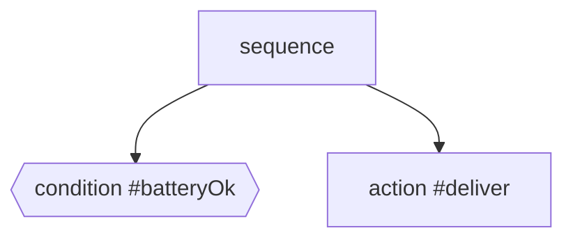

# Core concepts

## Ticks and responses

A behavior tree is evaluated by **ticking** it. A tick goes from the root
down to the children, and each node returns a
[`BTResponse`][beetea.bt.BTResponse] to its parent:

| Response  | Meaning                                                    |
| --------- | ---------------------------------------------------------- |
| `SUCCESS` | The node achieved its goal on this tick.                   |
| `FAILURE` | The node could not achieve its goal on this tick.          |
| `RUNNING` | The node is still working. Keep it active and tick it again. |

`tick()` must never block. Long-running work belongs in an
[`Action`][beetea.bt.Action], which runs in the background and reports
`RUNNING` until it finishes.

## Statuses

Each node also has an observable [`BTStatus`][beetea.bt.BTStatus], returned
by `get_status()`. The status mirrors the node's last response and has one
extra value:

| Status    | Meaning                                                         |
| --------- | --------------------------------------------------------------- |
| `SUCCESS`, `FAILURE`, `RUNNING` | Same as the last response.                |
| `SKIPPED` | The node is inactive. It has not been selected, or it was halted. |

Every node starts as `SKIPPED`. Responses drive control flow and statuses are
only for observation. Reading a status never changes how the tree runs.

## Reactivity

The composites ([`Sequence`][beetea.bt.Sequence] and
[`Fallback`][beetea.bt.Fallback]) are **reactive**: every tick starts again
from the first child. They do not remember which child was running.
Conditions placed before an action therefore act as guards, and they are
checked on every tick:

| Tick | `batteryOk` | `deliver` | Sequence |
| ---- | ----------- | --------- | -------- |
| 1    | SUCCESS     | RUNNING (launched)        | RUNNING |
| 2    | SUCCESS     | RUNNING                   | RUNNING |
| 3    | **FAILURE** | SKIPPED (halted)          | FAILURE |

When a composite stops at a child, it **halts** all later children that are
not already `SKIPPED`. This stops stale work from running outside the branch
that is currently selected.

## Activations and halting

`halt()` deactivates a node so that its next tick starts a new
**activation**:

- An `Action` discards its pending or completed result. The next tick runs
  the callable again.
- A composite halts its active children.
- A `BehaviorTree` stops its scheduler, if it has one, and halts its root.

!!! note "Python cannot kill threads"
    A halted `Action` whose callable is already executing keeps running until
    the callable returns. BeeTea tracks activations, so a result from an old
    activation is ignored and cannot overwrite the node's status. If you need
    to stop the work early, have the callable check a cancellation flag.

## Identity

Every node has an `id`: a name without whitespace that must be unique within
a `BehaviorTree`. You can pass one with `id=`. If you don't, BeeTea generates a
process-local ID such as `node-7`.

Lookup with [`find`][beetea.bt.BehaviorTree.find] and
[`replace`][beetea.bt.BehaviorTree.replace], events and snapshots all use the
`id`. Program output shows it as `#id`.
