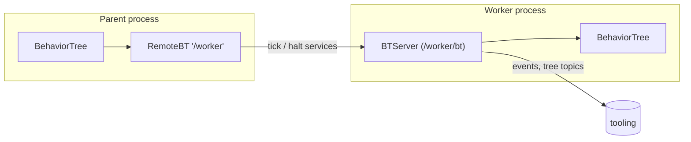

# ROS 2 integration

The optional `beetea.ros` module exposes trees over ROS 2. Execution and
synchronization stay in `beetea.bt`. This module only adds the transport.

!!! info "Requirements"
    `beetea.ros` imports `rclpy`, `std_srvs`, `beetea_msgs` and
    `svea_core.rosonic`. All of them must be available in your ROS 2
    environment. `import beetea` alone does not import this module.

The module has two adapters, both built on Rosonic resources:

| Class                                | Role                                              |
| ------------------------------------ | ------------------------------------------------- |
| [`BTServer`][beetea.ros.BTServer]    | Serves a local tree to other processes.           |
| [`RemoteBT`][beetea.ros.RemoteBT]    | A local node that ticks a tree served elsewhere.   |



## BTServer

```python
from svea_core import rosonic as rx
from beetea.ros import BTServer

server = rx.add(BTServer(my_root, namespace="/worker/bt"), node)
```

The namespace defaults to `None`, placing endpoints directly under the owner.
Factories can also be declared as methods with `@BTServer` or scoped explicitly:

```python
@BTServer(namespace="bt")
def init_bt(self):
    return BehaviorTree(my_root)
```

`behavior` can be:

- a `BTNode` or `BehaviorTree` instance, or
- a **callable** that takes the owner and returns the node.

The behavior is resolved at node startup. If it is not already a
`BehaviorTree`, it is wrapped in one. All interfaces live under the server's
namespace (default `None`, directly under the owner):

| Interface    | Type                          | Purpose                                                      |
| ------------ | ----------------------------- | ------------------------------------------------------------ |
| `tick`       | service `beetea_msgs/Tick`     | Ticks the tree. The response is the `BTResponse` as an int.    |
| `halt`       | service `std_srvs/Empty`       | Halts the tree.                                               |
| `snapshot`   | service `beetea_msgs/GetBTSnapshot` | Returns the revision, the tree as JSON and every node's status. |
| `events`     | topic `beetea_msgs/BTNodeEvent`  | One message per status transition (revision, node id, previous and new status). |
| `tree`       | topic `beetea_msgs/BTTree`       | The tree as JSON (from `to_dict()`), published at startup and after each replacement. Uses [`TREE_QOS`][beetea.ros.TREE_QOS] (transient local, depth 1). |

On shutdown the server removes its listeners and halts the tree.

## RemoteBT

```python
from beetea import BehaviorTree, Condition, Sequence
from beetea.ros import RemoteBT

remote = rx.add(RemoteBT("/worker", timeout=1.0, id="worker"), node)

tree = BehaviorTree(Sequence((Condition(ready), remote)))
```

`RemoteBT` is a **non-blocking** `BTNode` that uses the `tick` and `halt`
services under `<endpoint>/bt`. The `/bt` suffix is added if it is missing.

- Each local tick returns the **latest cached** remote response and sends a
  new tick request if none is pending. The first tick returns `RUNNING`.
- At most one tick request is pending at a time.
- If a tick request takes longer than `timeout` seconds, the cached response
  becomes `FAILURE` and the request is abandoned.
- If a request fails or the response is invalid, the cached response becomes
  `FAILURE`.
- `halt()` sends a halt request after any pending tick finishes, and resets
  the node to `SKIPPED`. Shutting down also halts the remote tree if it was
  active.

Because `RemoteBT` is an ordinary node, it can go inside sequences and
fallbacks, and it can also be [replaced](replacing.md).
